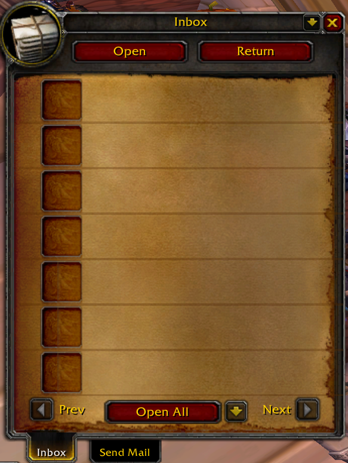

# Postal (3.3.5a, modified)

> Enhanced mailbox for World of Warcraft **3.3.5a**.

**This is not my addon.** Postal was written by **Xinhuan** (credits: Ammo, Rabbit, Grennon, Mikk) – original project: https://www.curseforge.com/wow/addons/postal

This repository contains version 3.4.0 with small adjustments for the Frostmourne Rebuffed client (version bumped to 3.4.1).

## Features
- Open All collects mail up to twice as fast.

## Installation
Copy the `Postal` folder into `World of Warcraft/Interface/AddOns/`, then `/reload`.

## License
The original addon ships without a license file; all rights remain with the original author. If you are the author and want this removed, please open an issue and it will be taken down.
